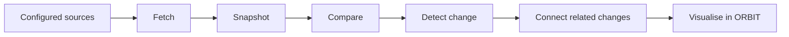

# ORBIT — Information Intelligence Interface

**Repository:** PULSE  
**Product concept:** ORBIT

ORBIT is an experimental interactive product experience for an information-intelligence platform. The concept is simple: monitor selected information sources, detect meaningful changes, and show how those changes relate.

This repository focuses on the product interface and its interactive 3D storytelling. It is a frontend concept/demo, not a claim that a production monitoring or ingestion backend is deployed.

## Product model



The interface uses this pipeline as a product narrative. Sample source names and snapshot differences shown in the demo are illustrative unless connected to a real data source.

## Interaction architecture

The experience is organised around a persistent 3D scene and a scroll-driven narrative:

| State | Story beat | Visual intent |
|---|---|---|
| 01 — Discover | See the system | Overview of the source network |
| 02 — Detect | Sources change | Focus on a changed source |
| 03 — Connect | Context changes | Show relationships between sources |
| 04 — Trace | Follow the signal | Highlight a path through related changes |
| 05 — Understand | See the whole picture | Return to the network overview |

Interactive source nodes support hover and click exploration. The demo workspace inspector presents sample change details.

## Technology

- React 19
- Vite
- Three.js
- Framer Motion
- Vanilla CSS
- Lucide React
- Oxlint

## Run locally

Requirements: a recent Node.js release compatible with the installed Vite version and npm.

```bash
git clone https://github.com/Kavyanjali07/PULSE.git
cd PULSE
npm install
npm run dev
```

Create a production build:

```bash
npm run build
npm run preview
```

Run lint checks:

```bash
npm run lint
```

## Design and architecture decisions

The detailed rationale is maintained in [DECISIONS.md](./DECISIONS.md). It records the interaction model, 3D scene behaviour, scroll states, responsive decisions, and visual system.

## Scope and limitations

- The repository demonstrates a frontend concept and interactive sample experience.
- Sample source events and change descriptions should not be interpreted as live monitoring results.
- A production version would require source connectors, secure credential handling, snapshot storage, change-detection services, relationship modelling, and operational monitoring.
- Performance and accessibility should be tested across real devices and reduced-motion settings.

## Author

Kavyanjali · [GitHub](https://github.com/Kavyanjali07) · [LinkedIn](https://www.linkedin.com/in/kavyanjali07)
